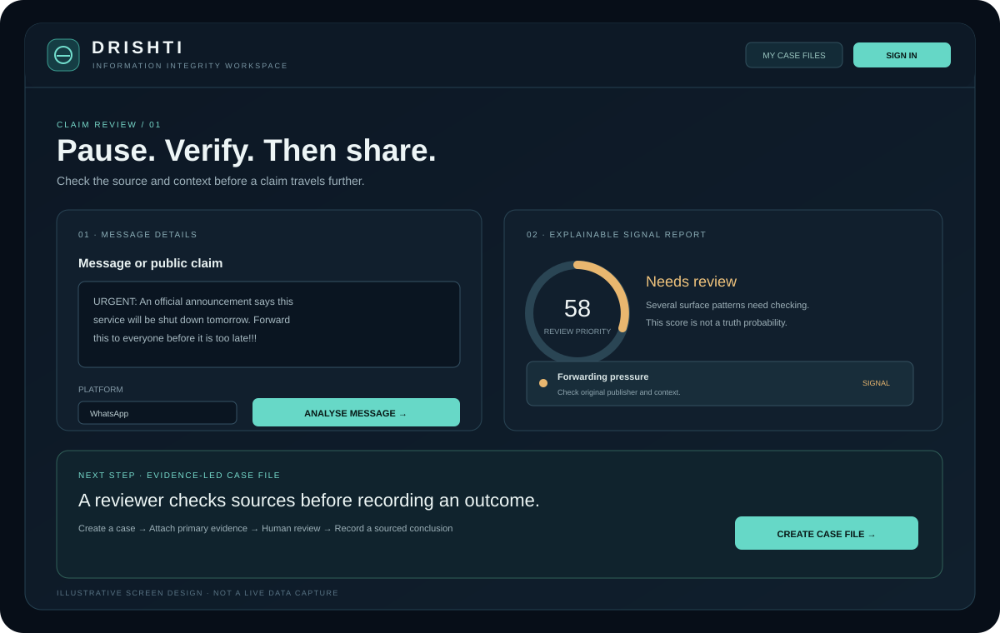
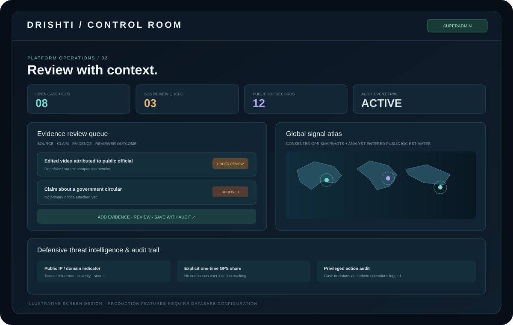
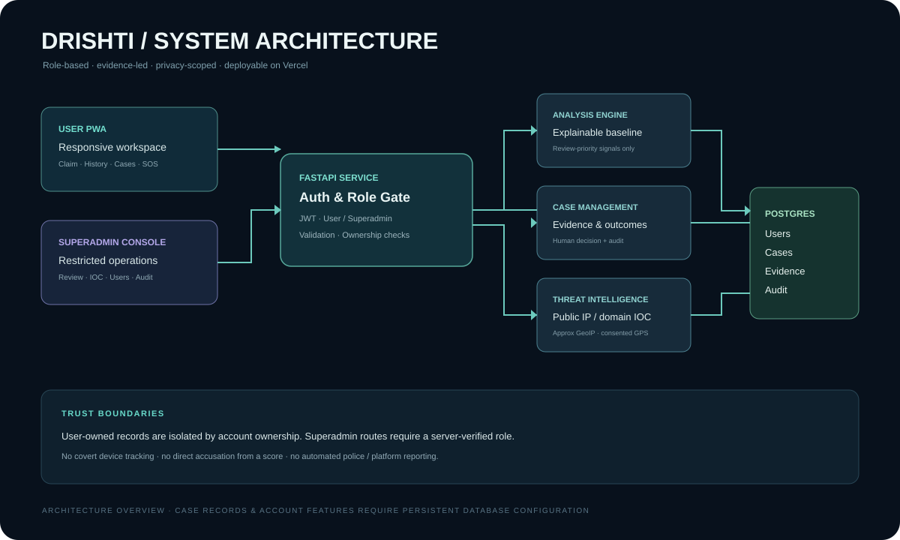

# DRISHTI

### Pause. Verify. Understand.

**An information-integrity and defensive cyber-incident review workspace.**

[User guide](docs/USER-GUIDE.md) · [Architecture](docs/ARCHITECTURE.md) · [ML research pipeline](ml/README.md) · [Security notes](SECURITY.md) · [Supabase setup](docs/SUPABASE-FREE-SETUP.md)

**Created by [Adarsh Singh Chauhan](https://github.com/Adarsh-Singh-Chauhan)**

---

## 1. The objective

Information moves faster than its context. A forwarded message may omit the original source, date or location. A genuine photograph may be reused with a false caption. A public figure's video may be edited or synthetically generated. A suspicious link may imitate an official notice. During a crisis, a misleading claim can spread before a reader has time to verify it.

**DRISHTI aims to create a responsible pause between receiving information and sharing it.**

It brings together:
- An accessible workspace for inspecting a public claim or message.
- Explainable indicators that show *why* a message may need closer attention.
- A case-file workflow for preserving a claim, source references and reviewer notes.
- A separate Superadmin console for human review and evidence-backed outcomes.
- A defensive public IP/domain indicator registry and privacy-scoped incident map.
- A mobile-ready Progressive Web App (PWA), safety requests and a 40-minute guided demo.

> **Core principle:** A signal is a reason to investigate—not proof that a claim is false. A person must never be labelled or penalised solely because an automated score, keyword or IP address says so.

## 2. Why this problem matters — selected evidence

The figures below are from published sources. They are context for the problem, **not measurements produced by DRISHTI**.

| Published evidence | What it tells us | Source |
| --- | --- | --- |
| **2,913 fact-checks** published by the PIB Fact Check Unit as of 1 April 2026 | Government information integrity is an active public-information challenge. The unit's remit relates to misinformation concerning the Central Government. | [Ministry of Information & Broadcasting / PIB · 1 Apr 2026](https://www.pib.gov.in/PressReleasePage.aspx?PRID=2247720&lang=1&reg=1) |
| **53%** of the India survey sample named WhatsApp as the biggest misinformation threat | Messaging platforms are an important part of the misinformation conversation. This is a survey of English-language Indian news users with internet access—not a representative estimate of every Indian resident. | [Reuters Institute · Digital News Report 2025: India](https://reutersinstitute.politics.ox.ac.uk/digital-news-report/2025/india) |
| **1,400+ URLs** targeted for blocking during the Operation Sindoor misinformation response, according to a PIB release | False or misleading online material can involve links and distribution channels as well as text. | [Ministry of Information & Broadcasting / PIB · 2 Apr 2026](https://www.pib.gov.in/PressReleasePage.aspx?PRID=2248361&lang=1&reg=3) |

### Real-world examples of manipulation

These are published fact-check / incident reports, **not DRISHTI detections**.

- **AI-generated video attributed to Lt Gen Rajeev Puri:** News On AIR reported a government clarification about a fake AI-generated video circulating in India in July 2026. [Read the report](https://newsonair.gov.in/government-debunks-fake-ai-generated-video-of-lt-gen-rajeev-puri/).
- **Manipulated police and minister videos:** AFP Fact Check reported on doctored clips shared around protests in August 2026, including altered audio compared with original footage. [Read the verification](https://factcheck.afp.com/doc.afp.com.C3KH4KF).

These cases illustrate why an effective workflow needs source provenance, original media, publication date, context, independent corroboration and a human reviewer—not a single keyword score.

## 3. The proposed solution

~~~text
SUBMIT
  ↓
INSPECT THE SIGNALS
  ↓
CHECK THE ORIGINAL SOURCE
  ↓
COLLECT EVIDENCE
  ↓
CREATE A CASE FILE
  ↓
HUMAN REVIEW
  ↓
RECORD A SOURCED OUTCOME
~~~

DRISHTI separates two very different questions:

1. **Does this message contain patterns that deserve a closer look?** The current baseline can flag a limited set of textual and link indicators.
2. **What does the available evidence establish?** This requires source review, context, corroboration and a human decision.

A case can be marked as received, under review, verified false, supported by sources, misleading context, insufficient evidence or closed. A reviewed conclusion requires an evidence summary and one or more source URLs.

## 4. Product preview

### User workspace

Users can submit a public claim, inspect matched indicators, read verification suggestions, create a case file and follow its status.

### Superadmin control room

The restricted console is designed for the single Superadmin role: evidence review, SOS queue, defensive IOC registry, user overview, notices, global signal atlas and audit trail.

### System architecture

See the full [architecture document](docs/ARCHITECTURE.md) and illustrated [user guide](docs/USER-GUIDE.md).

*Note: the SVGs above are illustrative UI/architecture designs for documentation. They are not screenshots of live user records.*

## 5. Product features

| Area | Capability | Role |
| --- | --- | --- |
| Claim analysis | Manual submission, platform selection, optional public source URL, explainable indicators and verification checklist | User |
| Analysis history | Private account history and per-record deletion | User |
| Evidence case files | Create a case from an analysed claim; track status and reviewer evidence | User |
| Case review | Review queue, evidence summary, source URLs, reviewer notes and sourced outcomes | Superadmin |
| Alerts | In-app review-priority and platform notices | User / Superadmin |
| Trusted contacts | Manage up to five user-owned trusted contacts | User |
| SOS workflow | Submit an internal safety/incident review request with optional, one-time GPS snapshot | User |
| SOS queue | Review, update status and add notes | Superadmin |
| Threat intelligence | Defensive registry for public IPv4/IPv6 and domain indicators, provenance, severity and status | Superadmin |
| Global signal atlas | Plot consented SOS GPS snapshots and analyst-entered approximate IOC locations | Superadmin |
| Audit trail | Review privileged actions and case / IOC changes | Superadmin |
| Mobile access | Responsive PWA shell, home-screen installation and cached static interface | User |
| Guided demo | Full interactive user and Superadmin workspaces, shared sample records, role switching and a 40-minute session | Public demo visitor |

### What the Superadmin can handle

The production Superadmin console is separate from the normal user workspace. It is intended to:
- Review incoming case files and decide what needs further investigation.
- Read the submitted claim and public source reference.
- Record an evidence summary, source URLs and reviewer notes.
- Choose a case outcome only when the required evidence is included.
- Review SOS submissions and optional location snapshots.
- Manage public network indicators, in-app notices and account overview.
- Inspect the audit trail for privileged activity.

There is no public Superadmin registration flow. The live Superadmin role must be assigned through the one-time bootstrap procedure documented in the repository.

### Cyber / IP location policy

The global map is an incident-context view—not a people-tracking system.

- Only user-consented, one-time GPS snapshots associated with an SOS can be shown as user locations.
- IP geolocation is approximate and describes a network edge/region; it can be inaccurate because of VPNs, proxies, carrier NAT and shared cloud egress.
- IOC coordinates are entered by an authorised Superadmin with a source reference.
- DRISHTI does not silently capture visitor IPs, identify a person from an IP address or show someone's live movement.
- Private, local and reserved IP ranges are rejected by the IOC API.

## 6. The 40-minute interactive product demo

**A browser-only, role-based product sandbox with end-to-end sample workflows.**

[**Open the DRISHTI interactive demo**](https://dristhi-five.vercel.app/demo.html)

Two fictional demo roles are available:

| Demo role | Demo ID | Password |
| --- | --- | --- |
| Mobile / User | `demo.user@drishti.in` | `DRISHTI-USER-40` |
| Superadmin control room | `demo.superadmin@drishti.in` | `DRISHTI-ADMIN-40` |

### User workspace modules

- **Overview:** personal case counts, pending reviews, notifications and recent activity.
- **Analyse a claim:** select a platform, enter a public claim or load a sample, inspect the review-priority score, matched signals and verification checklist.
- **My case files:** search and filter submitted sample cases, open a case detail and inspect its evidence summary and timeline.
- **Alerts & SOS:** view notices, submit a fictional internal safety request and follow its sample status.
- **Trusted contacts:** add and remove fictional contacts for the safety workflow.
- **Analysis history:** inspect the analyses run during the demo.
- **Guide and methodology:** understand the steps, baseline rules and limitations.

### Superadmin workspace modules

- **Overview:** open case queue, SOS requests, IOC entries and audit-event counts.
- **Evidence case desk:** open any sample case, add evidence URLs and a written evidence summary, record reviewer notes and save a review outcome.
- **SOS review queue:** review and update sample request status.
- **Global signal atlas:** inspect explicitly labelled synthetic map points.
- **Threat intelligence:** add demo-only public IP/domain examples and update their sample status.
- **User accounts:** inspect a read-only fictional account directory.
- **In-app notices:** compose sample notices that appear in the user notification centre.
- **Audit trail:** inspect privileged actions recorded during the demo.

### Follow one case across both roles

1. Sign in as the Mobile / User role and open **Analyse a claim**.
2. Run a sample analysis and choose **Create a case file**.
3. Open **My case files** and note the generated case ID.
4. Use **Switch demo role** in the left sidebar or top bar. Choose the Superadmin role. The existing case remains in the same sample dataset and the 40-minute countdown does not reset.
5. Open **Evidence case desk**, select the case, add a source URL and evidence summary, then save a review decision.
6. Switch back to the User role and confirm the case status and reviewer evidence in **My case files**.

The Superadmin demo enforces the demonstration workflow rule that a final outcome (verified false, supported by sources or misleading context) needs an evidence summary and at least one HTTP/HTTPS source URL. No external URL lookup, publication, takedown or notification is performed.

### Session and data boundary

- A 40-minute countdown starts when the first demo role launches.
- Switching between demo roles preserves the same expiry time and sample records.
- Demo records are stored in the active browser tab's `sessionStorage`; they are not sent to the production API or persisted in a database.
- Exiting or expiring the demo clears the local session and sample changes.
- The timer and role selection are client-side demonstration controls—not production authentication or a security boundary.
- Public demo credentials cannot access real users, production case files or the real Superadmin console.

## 7. Public website routes

The deployed Vercel project serves static product assets from `public/`. Use these public paths:

| Route | Purpose |
| --- | --- |
| `/` | Product landing page, published context figures, incident reports, workflow and product tour |
| `/app.html` | Main User workspace, analysis and case-file interface |
| `/demo.html` | Public 40-minute User + Superadmin sandbox |
| `/guide.html` | Illustrated desktop, mobile, case-file and Superadmin user guide |
| `/admin.html` | Production Superadmin sign-in (requires database and a promoted admin account) |
| `/alerts.html` | User alerts, trusted contacts and internal SOS workflow |
| `/docs` | FastAPI OpenAPI / Swagger UI |

Legacy `/frontend/...` links redirect to the matching public route. The product homepage and screen illustrations distinguish external published evidence and illustrative mock screens from DRISHTI-generated output.

## 8. Multilingual model and graph research

The repository now includes a research-only training pipeline for **mBERT** and **XLM-RoBERTa**, plus a NetworkX graph-metrics module:

- `ml/train_text_classifier.py`: trains four evidence-oriented classes using a curator-supplied CSV with language, source URL, publisher, licence and verification provenance.
- `ml/predict_text.py`: local inference with a configurable confidence threshold and an `uncertain` abstention state.
- `ml/graph_signals.py`: descriptive graph and synchronisation metrics for pseudonymised, analyst-prepared public interaction edges.
- `ml/README.md`: data contract, commands, evaluation gates and responsible-use boundaries.

**These are not currently connected to the production API.** No trained weights or licensed/human-verified training corpus are included in this repository. The live analyser remains the rule-based baseline described above. Do not present mBERT/XLM-RoBERTa, NetworkX bot analysis, social-platform crawling, or Gemini Q&A as live features until those components have been trained or configured, evaluated, integrated and enabled behind reviewed feature flags.

A model output may prioritise human attention; it must never automatically set a case to Verified false, identify a person, label an account as a bot, trigger law-enforcement referral or take down content.

## 9. Current analysis methodology and limitations

The current production baseline is a **deterministic, explainable rule-based text analyser**. It is not a trained AI / machine-learning classifier and is not a web fact-checking service.

Current signals include:
- Urgency language.
- Pressure to forward or redistribute.
- Authority claims without a verifiable source in the submitted text.
- Forward-chain markers.
- Panic or threat wording.
- Selected common URL shorteners.
- Excessive capitalisation and repeated punctuation.

The output is a review-priority score and matched signal explanations. It is **not**:
- A probability that a claim is false.
- A credibility score for a person or organisation.
- A political viewpoint, ideology or sentiment classifier.
- A malware scan or URL safety verdict.
- A live social-media monitoring service.
- An automated reporting, account suspension or takedown mechanism.

The current baseline does not independently browse the web to check sources, authenticate official notices, inspect images/video/audio, recognise all deepfakes, attribute coordinated actors or identify people behind IP addresses. Urgent legitimate emergency communication can trigger a false positive; subtle and newly emerging misinformation can be missed.

### Planned research (not represented as implemented)

- Evaluate mBERT / XLM-RoBERTa on properly sourced Hindi, English and code-mixed datasets.
- Source registry and fact-check publisher integrations with provenance.
- OCR, image provenance and media-forensics research.
- Official / approved platform API integrations for public content.
- Privacy-preserving repetition/timing and graph analysis on lawful public metadata.
- Safe URL expansion and external reputation integrations.

## 10. Technology stack

| Layer | Technology |
| --- | --- |
| Backend | Python 3.11+, FastAPI, Pydantic |
| Authentication | JWT bearer tokens (HS256), scrypt password hashing |
| Database | SQLite for local development; PostgreSQL when configured |
| Frontend | HTML5, CSS3, Vanilla JavaScript |
| API documentation | OpenAPI, Swagger UI, ReDoc |
| PWA | Web app manifest, service worker, browser installation |
| Deployment | Vercel |
| Testing | pytest |
| Containers | Docker, Docker Compose |

## 11. Architecture and API

Full diagrams, trust boundaries, data model, routes and threat model: [docs/ARCHITECTURE.md](docs/ARCHITECTURE.md).

Important routes:

| Method | Endpoint | Purpose |
| --- | --- | --- |
| GET | `/health` | Health and storage status |
| POST | `/api/v1/auth/register` | Create a user account |
| POST | `/api/v1/auth/login` | User sign-in |
| GET | `/api/v1/auth/me` | Read current account and role |
| POST | `/api/v1/analyze` | Analyse submitted text |
| GET / DELETE | `/api/v1/history` | Read or delete current user's history |
| POST | `/api/v1/cases` | Create a case file |
| GET | `/api/v1/cases/mine` | Read current user's case files |
| GET / PATCH | `/api/v1/admin/cases` | Superadmin case review queue / evidence update |
| GET / POST / PATCH | `/api/v1/admin/network-indicators` | Superadmin public IOC registry |
| GET / POST / PATCH | `/api/v1/admin/sos` | Superadmin SOS review workflow |

Live API documentation: [Swagger UI](https://dristhi-five.vercel.app/docs).

## 12. Live deployment and storage status

The website and static frontend are deployed on Vercel. **The connected Vercel project currently has no `DATABASE_URL` configured.**

This means the production health endpoint reports storage as unconfigured. Until persistent PostgreSQL is connected:
- Anonymous analysis can run where the API is available.
- User registration and login cannot be used in production.
- Analysis history, real case files, alerts, trusted contacts and SOS records cannot persist.
- The real Superadmin console cannot operate on production records.
- The public 40-minute demo remains available because it is a separate local browser simulator.

The case-file API and interfaces are now in the repository, but durable production use is blocked by database configuration. See [Supabase Free & first-admin setup](docs/SUPABASE-FREE-SETUP.md). Do not put database credentials in this README or GitHub.

## 13. Run locally

**Requirements:** Python 3.11+, Git and a modern browser. Docker is optional.

### Clone

~~~bash
git clone https://github.com/Adarsh-Singh-Chauhan/dristhi.git
cd dristhi
~~~

### Start the API (Windows PowerShell)

~~~powershell
python -m venv .venv
.venv\Scripts\Activate.ps1
pip install -r backend/requirements.txt
$env:JWT_SECRET_KEY = "replace-with-a-long-random-secret"
$env:DATABASE_PATH = "data/drishti.db"
uvicorn app.main:app --app-dir backend --reload
~~~

### Start the frontend

In a second terminal:

~~~powershell
cd frontend
python -m http.server 5500
~~~

Open `http://127.0.0.1:5500`. The local frontend calls the API at `http://127.0.0.1:8000` by default.

API docs: `http://127.0.0.1:8000/docs`  
Health: `http://127.0.0.1:8000/health`

### Tests

~~~bash
pip install -r backend/requirements.txt
pytest backend/tests -q
~~~

### Docker

Copy `.env.example` to `.env`, configure a private `JWT_SECRET_KEY`, then run:

~~~bash
docker compose up --build
~~~

Never commit `.env`, database files, access tokens, password hashes or real case content.

## 14. First Superadmin setup

1. Configure a persistent PostgreSQL database using [docs/SUPABASE-FREE-SETUP.md](docs/SUPABASE-FREE-SETUP.md).
2. Add `DATABASE_URL` and a high-entropy `JWT_SECRET_KEY` as private Vercel environment variables.
3. Deploy and confirm `/health` reports PostgreSQL storage.
4. Register the account that should become the real Superadmin.
5. Follow the one-time local bootstrap steps in `scripts/promote_first_admin.py`.
6. Sign in at [Superadmin Control Room](https://dristhi-five.vercel.app/admin.html).

Never publish the production Superadmin email/password in README, demo, source code, issue comments or screenshots.

## 15. Responsible use & security

- Keep analysis viewpoint-neutral: criticism, political debate, journalism, satire and dissent must not be treated as false solely because of their position or tone.
- Never use a keyword match or score as proof.
- Preserve primary-source links, dates, context and uncertainty.
- Require human review and evidence before a case receives a verified conclusion.
- Do not collect private messages without consent and a valid legal basis.
- Do not infer a person's identity or precise location from an IP address.
- Do not automate public accusations, takedowns, emergency dispatch or law-enforcement referrals.
- Use HTTPS, private secrets, restricted CORS, database backups and access logging before public operational use.
- DRISHTI SOS is an internal review request; it does not dispatch emergency services.

This project is an engineering prototype and has not undergone an independent security audit. See [SECURITY.md](SECURITY.md) for responsible reporting guidance.

## 16. Contributing

Contributions are welcome in accessibility, security review, multilingual evaluation, source-verification workflows, documentation and responsible AI research.

Any new model, data collection or platform integration should document provenance, licensing, consent, limitations, false positives, false negatives and human-review requirements.

## 15. Contact

**Adarsh Singh Chauhan**

- GitHub: [Adarsh-Singh-Chauhan](https://github.com/Adarsh-Singh-Chauhan)
- LinkedIn: [Connect on LinkedIn](https://www.linkedin.com/in/adarsh-singh-5189b9283/)
- Portfolio: [Engineering Portfolio](https://adarsh-engineering-portfolio-rust.vercel.app/)
- Email: [Request a DRISHTI walkthrough](mailto:adarshsinghchauhan904@gmail.com?subject=DRISHTI%20Product%20Walkthrough)

---

**DRISHTI — A better pause before the next share.**

Built to support evidence, clarity and human judgement. Verify independently. Share responsibly.

