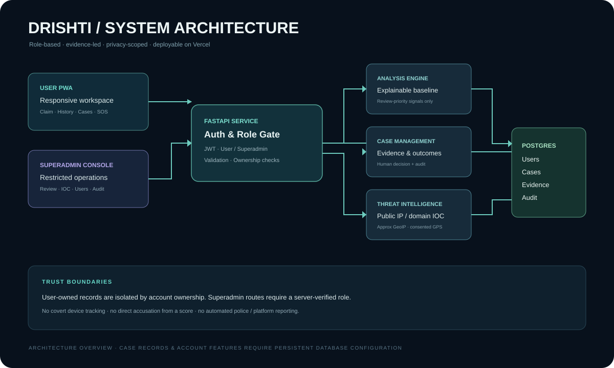
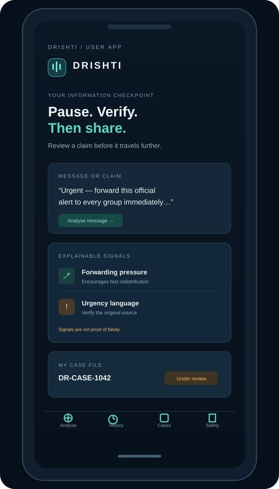

# DRISHTI — System Architecture

**Status:** Prototype architecture, updated 2 November 2026  
**Repository:** [Adarsh-Singh-Chauhan/dristhi](https://github.com/Adarsh-Singh-Chauhan/dristhi)

DRISHTI is an information-integrity and defensive cyber-incident review workspace. It is designed to help a user capture a suspicious public claim, understand why it may need review, collect source evidence and route a structured case to a human reviewer.

> **Trust boundary:** An automated signal is not a truth verdict. A public IP address is not a person. A submitted SOS is not an emergency dispatch.

The mobile image is a UI concept for the responsive PWA, not a screenshot of a live account.

## 1. Product roles

| Role | Access | Responsibility |
| --- | --- | --- |
| User | Main PWA workspace | Submit authorised public content, inspect signals, manage private history, create case files, manage trusted contacts and submit optional-location SOS requests. |
| Superadmin | Separate, role-protected console | Review case files and SOS requests, record evidence-backed outcomes, manage public IOC entries and in-app notices, inspect accounts and audit events. |
| Demo user | 40-minute browser-only tour | Explore sample analysis, case creation, phone-first navigation and sample case tracking. No production data access. |
| Demo Superadmin | 40-minute browser-only tour | Explore the sample case queue, sample atlas and audit presentation. No real admin privileges or server-side changes. |

The production backend validates the Superadmin role from the stored user record. Hiding an admin link in the frontend is not treated as access control.

## 2. High-level architecture

~~~mermaid
flowchart LR
  U[User PWA] -->|HTTPS / JSON| API[FastAPI API]
  A[Superadmin Console] -->|HTTPS / JSON + JWT| API
  API --> AUTH[Authentication and role gate]
  AUTH --> ANALYZER[Explainable signal baseline]
  AUTH --> CASES[Case file workflow]
  AUTH --> OPS[Alerts, SOS and admin operations]
  AUTH --> IOC[Public IP / domain IOC registry]
  ANALYZER --> DB[(PostgreSQL / SQLite local)]
  CASES --> DB
  OPS --> DB
  IOC --> DB
~~~

### Runtime components

| Component | Current implementation | Notes |
| --- | --- | --- |
| Public landing page | Static HTML/CSS under `public/` | External evidence, incident references, product workflow, feature overview and demo entry. |
| User workspace | HTML, CSS, vanilla JavaScript | Published static route `/app.html`, backed by the FastAPI API where available. |
| Demo portal | Static HTML/CSS/JS | Published static route `/demo.html`; two public sample roles, shared 40-minute tab-scoped sandbox, not production authentication. |
| Admin console | Separate static page + JavaScript | Published route `/admin.html`; uses server-side role checks for every real admin API action. |
| API | FastAPI / Python | Vercel Python function entrypoint with OpenAPI and Swagger UI. |
| Analysis | Deterministic, explainable text rules | Current production baseline only; no web verification or trained ML inference. |
| Database | SQLite for local development; PostgreSQL when `DATABASE_URL` is set | Vercel filesystem is ephemeral; production account features need persistent PostgreSQL. |
| Deployment | Vercel | Static frontend and Python API in one repository. |

## 2A. Public route and static asset topology

The Vercel project exposes the product pages from the repository's `public/` directory. The Python entrypoint (`index.py`) serves `public/index.html` at the root route. Static documents and assets are served at these paths:

| Public route | Page / asset |
| --- | --- |
| `/` | Public landing page |
| `/app.html` | Main user workspace |
| `/demo.html` | Browser-only 40-minute demo |
| `/guide.html` | Illustrated product guide |
| `/admin.html` | Real Superadmin login and console |
| `/alerts.html` | Alerts, trusted contacts and SOS |
| `/images/*.svg` | Illustrative desktop, mobile, admin and architecture screens |

Legacy URLs under `/frontend/...` redirect to their public equivalents. The demo page and its JavaScript/CSS are static assets and do not call the production API.

## 3. Claim analysis and case-file flow

~~~mermaid
sequenceDiagram
  actor User
  participant PWA as User PWA
  participant API as FastAPI
  participant Rules as Signal baseline
  participant DB as Persistent database
  participant Admin as Superadmin

  User->>PWA: Submit authorised claim and optional public source URL
  PWA->>API: POST /api/v1/analyze
  API->>Rules: Inspect selected wording and link patterns
  Rules-->>API: Matched signals + review priority + suggested checks
  API-->>PWA: Explainable result and limitations
  User->>PWA: Create case file
  PWA->>API: POST /api/v1/cases (JWT required)
  API->>DB: Store claim, category, source and status=received
  API-->>PWA: Case ID / received
  Admin->>API: GET /api/v1/admin/cases
  API->>DB: Fetch queue with reporter and evidence
  Admin->>API: PATCH /api/v1/admin/cases/{id}
  API->>DB: Store status, evidence URLs, reviewer notes and audit event
  API-->>Admin: Updated case status
~~~

### Case status definitions

| Status | Meaning |
| --- | --- |
| `received` | Submitted by a user; not yet reviewed. |
| `under_review` | A human reviewer is examining the claim and evidence. |
| `verified_false` | A reviewer concluded the submitted claim is false or manipulated and recorded a source-backed summary. |
| `supported_by_sources` | The submitted claim is supported by the evidence cited by the reviewer. This does not mean every detail is universally proven. |
| `misleading_context` | The material may be genuine, but date, location, framing or context changes its meaning. |
| `insufficient_evidence` | Available evidence does not support a reliable conclusion. |
| `closed` | The review is closed without a stronger public conclusion. |

The API requires an evidence summary and at least one HTTP/HTTPS source URL before saving the three outcome states `verified_false`, `supported_by_sources` or `misleading_context`. An analysis score alone cannot create a verified finding.

## 4. API surface

### User routes

| Method | Endpoint | Purpose |
| --- | --- | --- |
| GET | `/health` | Service and storage status. |
| POST | `/api/v1/auth/register` | Register a user. |
| POST | `/api/v1/auth/login` | Sign in and obtain a short-lived bearer token. |
| GET | `/api/v1/auth/me` | Return the current user and stored role. |
| POST | `/api/v1/analyze` | Return review signals; may save a short history summary for a signed-in user. |
| GET | `/api/v1/history` | List the current user's saved analyses. |
| DELETE | `/api/v1/history/{analysis_id}` | Delete one of the current user's records. |
| POST | `/api/v1/cases` | Create a private case file from an authorised claim. |
| GET | `/api/v1/cases/mine` | List the current user's own case files. |
| GET / POST / DELETE | `/api/v1/trusted-contacts` | Manage up to five user-managed trusted contacts. |
| POST / GET | `/api/v1/sos` | Submit and view the current user's SOS review requests. |
| GET / POST | `/api/v1/alerts` | Read in-app alerts and mark them read. |

### Superadmin routes

| Method | Endpoint | Purpose |
| --- | --- | --- |
| GET | `/api/v1/admin/overview` | Overview counts for users, SOS, alerts, public indicators and cases. |
| GET / PATCH | `/api/v1/admin/cases` | Read the case queue and save evidence-backed outcomes. |
| GET / PATCH | `/api/v1/admin/sos` | Review user-submitted SOS requests. |
| GET / POST | `/api/v1/admin/alerts` | Publish and inspect in-app notices. |
| GET | `/api/v1/admin/users` | Account overview; no password hashes are returned. |
| GET | `/api/v1/admin/audit` | Review privileged-action audit events. |
| GET / POST / PATCH | `/api/v1/admin/network-indicators` | Manage public IP/domain IOCs and review state. |

## 5. Data model

Core relational records:

- `users`: account identity, password hash, stored role and creation time.
- `analyses`: user-owned short report excerpt, source metadata and explainable signal output.
- `case_files`: user-owned claim, category, submitted source, reviewer status, evidence summary, evidence URLs, notes and reviewer identity.
- `alerts`: user-targeted or platform-wide in-app notices.
- `trusted_contacts`: user-managed contact references.
- `sos_reports`: incident report, review state and optional one-time user-shared GPS snapshot.
- `network_indicators`: manually entered public IP/domain, severity, provenance, analyst-supplied approximate location and review status.
- `admin_audit_log`: privileged action, actor, entity, metadata and timestamp.

The API uses ownership checks for user-specific history, cases and contacts. The Superadmin API is role-restricted and records case and indicator review changes in the audit log.

## 6. Global map and location policy

The Global Signal Atlas is an incident/indicator map, not a people-tracking map.

- **User GPS:** only captured when the user explicitly opts in while submitting a particular SOS. It is a one-time snapshot for that report.
- **IP geolocation:** city/region estimates can be wrong because of VPNs, proxies, carrier NAT, cloud gateways and shared egress. Coordinates must be treated as approximate network metadata.
- **IOC map points:** added by an authorised Superadmin with a documented source. The application does not silently collect visitors' IP addresses.
- **No live tracking:** DRISHTI does not stream device coordinates or track a person's movements.
- **No actor attribution:** an IP address does not identify a specific person.

## 7. Threat model and controls

| Threat | Control / design choice |
| --- | --- |
| A user tries to open the admin panel | Server-side role check on every admin API route. |
| One user reads another user's data | User-owned SQL queries are scoped by authenticated user ID. |
| A fake claim is treated as proven | Signal score is labelled review priority; final outcomes require a human, evidence summary and source URL. |
| A malicious user enters a private IP as an IOC | API rejects non-global, private, local and reserved IP ranges. |
| A map exposes precise location without consent | GPS is optional and only associated with a submitted SOS. |
| Demo credentials are used against production | Demo login is a separate browser-only simulator; it does not call production admin APIs. |
| Admin decisions are untraceable | Case / IOC / SOS decisions create audit events. |
| Secrets leak into source control | JWT and database values belong in Vercel environment variables, never in README or code. |

This repository is a prototype and has not been independently security-audited. Before public operational use, add rate limits, email verification and account recovery, backup/retention policy, monitoring, dependency scanning, incident response, privacy impact assessment and independent security testing.

## 8. What's implemented versus planned

### Implemented in the repository

- Responsive user workspace and installable PWA shell.
- User registration/login and stored role support.
- Superadmin console, user overview and audit trail.
- Explainable baseline analysis and saved history.
- Evidence-led case-file create/list/review APIs and UI.
- Alerts, trusted contacts and SOS workflows.
- Optional SOS GPS snapshots.
- Superadmin-managed public IP/domain IOC registry and privacy-scoped global map.
- 40-minute sample demo for mobile user and demo Superadmin.
- Landing page, guide and architecture diagrams.

### Requires production database configuration

Vercel's current environment does not contain `DATABASE_URL`. Until a persistent PostgreSQL database is connected, live registration, login, saved history, real case-file persistence, SOS persistence and real Superadmin operations will return a storage-not-configured response. Local development uses SQLite. Do not mistake the browser-only demo for production authentication.

### Future engineering (not currently implemented)

- mBERT / XLM-RoBERTa or other multilingual model inference and per-language calibration.
- Source registry, fact-check publisher integrations and automated source matching.
- Image/video/audio forensic integrations, OCR and media provenance checks.
- Official / permitted social APIs for public-content collection.
- NetworkX graph analysis on lawfully obtained, privacy-minimised public metadata.
- Automated threat-feed ingestion, sandboxed URL expansion and reputation checks.
- Production-native Android/iOS applications; current phone experience is a PWA.

## 8A. Multilingual model and graph research boundary

The optional `ml/` directory is a separate, offline research workflow. It does not run inside the current production API.

- mBERT and XLM-RoBERTa training requires a privately curated, licensed and human-verified dataset.
- The dataset contract preserves language, source URL, source publisher, reuse licence, verification timestamp and curator-assigned train/validation/test split.
- The training script reports aggregate and per-language validation/test results and writes a dataset-hash model card.
- Local inference abstains below its confidence threshold. The output is only a triage signal.
- `ml/graph_signals.py` provides descriptive NetworkX metrics over pseudonymised public interaction edges supplied by an analyst. It does not scrape social platforms, identify people, declare bots or attribute campaigns.
- No trained weights, private message corpus, social-platform API credentials or Gemini configuration are supplied in the repository.

Before a model is considered for production, require independent language-wise evaluation, calibration, false-positive/false-negative review, licence/consent validation, source provenance, model versioning and a rollback mechanism. Model output must never directly set a conclusive case status or trigger moderation.

## 9. Local run

~~~bash
python -m venv .venv
.venv\\Scripts\\Activate.ps1
pip install -r backend/requirements.txt
$env:JWT_SECRET_KEY = "replace-with-a-long-random-secret"
$env:DATABASE_PATH = "data/drishti.db"
uvicorn app.main:app --app-dir backend --reload
~~~

In another terminal:

~~~bash
cd frontend
python -m http.server 5500
~~~

Open `http://127.0.0.1:5500`. API documentation is available at `http://127.0.0.1:8000/docs`.

For hosted deployment, set `DATABASE_URL`, `JWT_SECRET_KEY` and `CORS_ORIGINS` as Vercel project environment variables. Never commit their values.

## 10. Demo accounts

The public `/demo.html` page uses fictional browser-only credentials:

| Demo role | Demo ID | Password |
| --- | --- | --- |
| Mobile / User | `demo.user@drishti.in` | `DRISHTI-USER-40` |
| Superadmin tour | `demo.superadmin@drishti.in` | `DRISHTI-ADMIN-40` |

The session is stored in `sessionStorage` and expires after 40 minutes in that tab. These accounts are intentionally public and must never be used as real accounts. Demo changes affect only sample data in the active browser tab.

