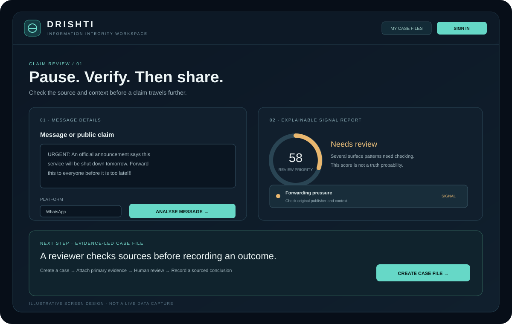
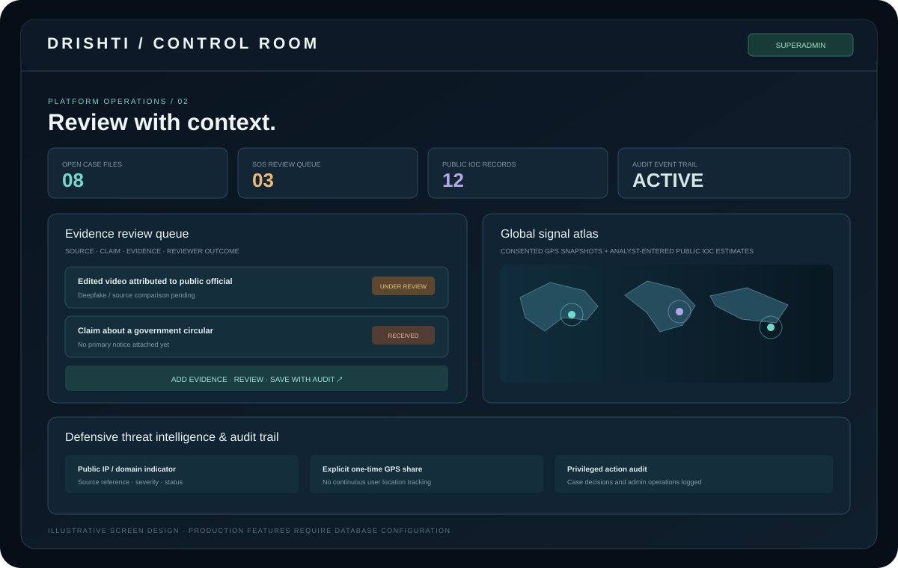

# DRISHTI — User & Superadmin Guide

This is the working guide for the current repository. It distinguishes the live anonymous analyser, authenticated production features (which require PostgreSQL configuration), and the public browser-only demonstration.

## 1. Open DRISHTI

- [Public website](https://dristhi-five.vercel.app/)
- [User workspace](https://dristhi-five.vercel.app/app.html)
- [40-minute guided demo](https://dristhi-five.vercel.app/demo.html)
- [Illustrated guide](https://dristhi-five.vercel.app/guide.html)
- [Superadmin console](https://dristhi-five.vercel.app/admin.html)
- [Alerts & SOS](https://dristhi-five.vercel.app/alerts.html)
- [API health](https://dristhi-five.vercel.app/health)
- [Swagger API reference](https://dristhi-five.vercel.app/docs)

### Current production status (verified 3 November 2026)

The Vercel health response currently reports:

```json
{
  "status": "ok",
  "service": "drishti-api",
  "version": "0.4.0",
  "storage": "unconfigured"
}
```

The API is deployed, but persistent account storage is not configured. Production registration/login, saved analysis history, real case files, alerts, trusted contacts, SOS records and Superadmin data operations are therefore unavailable until PostgreSQL is connected.

## 2. Understand the three environments

| Environment | What works | Data boundary |
|---|---|---|
| Public landing page | Product overview, navigation, workflow, guide, external evidence | Static website |
| Anonymous live analyser | Rule-based analysis when API is healthy | No durable account history without configured storage |
| 40-minute demo | Fictional User + Superadmin walkthrough, case handoff and sample operations | Browser `sessionStorage`; isolated from production API |
| Local development | SQLite-backed registration, API, history and tests | Local database file |
| Production authenticated workspace | Intended to use JWT and PostgreSQL | Blocked until persistent `DATABASE_URL` is configured |

## 3. User workspace — analyse a message



1. Open the user workspace.
2. Paste a public claim or text you are authorised to review. Avoid passwords, credentials, private conversations and unnecessary personal data.
3. Select the platform where you found the content.
4. Add the original public source URL when available.
5. Submit for analysis.
6. Read the review-priority score, matched indicators and their explanations.
7. Use the recommended checks to look for the original publisher, date, location, original media and independent corroboration.

The analyser is deterministic and rule-based. It checks selected urgency, forwarding pressure, authority wording, panic wording, shortened URLs and formatting. A score is not a probability of falsity and cannot establish truth.

## 4. Sign-in and registration

The user workspace has a sign-in/register flow backed by FastAPI endpoints:

- `POST /api/v1/auth/register`
- `POST /api/v1/auth/login`
- `GET /api/v1/auth/me`

Passwords are hashed using scrypt; API sessions use JWT bearer tokens. The live production account flows are blocked while health reports `storage: unconfigured`.

### Local sign-up test

1. Follow the root README's local backend startup instructions.
2. Open the local frontend served from `frontend/`.
3. Choose Sign in, then switch to Create account.
4. Register with a test email and a unique development password.
5. Sign in and verify the user profile.
6. Analyse a sample and check saved history.

Do not reuse a production or personal password in tests.

## 5. Analysis history and case files

When persistent storage is available:

1. Sign in.
2. Run an analysis and enable history saving.
3. Open Analysis history to read or delete your own reports.
4. Create a case from an analysis.
5. Open My case files and follow the case status.

Possible statuses include received, under review, verified false, supported by sources, misleading context, insufficient evidence and closed. Evidence-backed outcomes require a reviewer summary and at least one source URL.

## 6. Alerts, trusted contacts and SOS

1. Open [Alerts & SOS](https://dristhi-five.vercel.app/alerts.html).
2. Sign in with a normal user account.
3. Add trusted contact details you want to reference in the safety workflow.
4. Enter an incident title and details.
5. Add a public source URL where relevant.
6. Location sharing is optional. If enabled, the browser requests GPS permission and sends a one-time location snapshot for that SOS report.
7. Submit and check the review status later.

**Important:** SOS is an internal review queue. It does not call emergency services, police, SMS, WhatsApp or trusted contacts automatically. For a real emergency, contact local emergency services directly.

## 7. Superadmin control room



Production setup:

1. Connect persistent PostgreSQL using [Supabase setup](SUPABASE-FREE-SETUP.md).
2. Apply the SQL migration.
3. Register the intended administrator account using the normal sign-up flow.
4. Promote that existing account with `scripts/promote_first_admin.py` as documented in the setup guide.
5. Open the Superadmin console and sign in.
6. Review cases, add evidence URLs and summary, record notes, and save an outcome.
7. Review SOS reports, manage in-app notices and public IOC entries, and inspect the audit trail.

There is no public Superadmin sign-up route. Never store or publish the production admin password.

## 8. Public 40-minute sandbox

[**Open DRISHTI demo**](https://dristhi-five.vercel.app/demo.html)

| Demo role | Email / ID | Password |
|---|---|---|
| Mobile / User | `demo.user@drishti.in` | `DRISHTI-USER-40` |
| Superadmin control room | `demo.superadmin@drishti.in` | `DRISHTI-ADMIN-40` |

Suggested tour:

1. Enter as the demo User.
2. Open Overview and run the sample message analysis.
3. Create a sample case file.
4. Open My case files and note the case ID.
5. Choose Switch demo role and enter the demo Superadmin workspace.
6. Open Evidence case desk, select the sample case, add a source and evidence summary, then save a demo outcome.
7. Switch back to the User role and read the updated sample case.

Demo rules:

- Both roles share the same synthetic sample dataset for the active tab/session.
- The 40-minute session expiry is shared across role switches.
- Data is held in `sessionStorage` and cleared when the session expires or is exited.
- The demo does not call the production API, access real accounts, create real notices or deliver notifications.
- Public demo credentials are not production credentials.

## 9. Install the PWA

**Android Chrome:** open the HTTPS workspace → browser menu → Install app / Add to Home screen.

**iPhone Safari:** open the HTTPS workspace → Share → Add to Home Screen.

The service worker caches static interface files but deliberately does not cache API, health or authenticated responses. Offline access does not make account actions or analysis work without the backend.

## 10. Troubleshooting

| Symptom | Likely cause | Action |
|---|---|---|
| Accounts pending | Health reports `storage: unconfigured` | Configure PostgreSQL `DATABASE_URL`, run migration, redeploy |
| API unavailable | Backend deployment or network issue | Check [health](https://dristhi-five.vercel.app/health) and Vercel runtime logs |
| User cannot enter Superadmin | Account role is `user` | Promote one account using the private first-admin procedure |
| Demo data disappears | Session expired or browser tab/session ended | Start a new demo session; demo data is intentionally temporary |
| GPS not attached | Permission denied, unavailable or timed out | Retry or submit without optional location |
| PWA shows old assets | Browser service worker cache | Close/reopen, then clear site data or refresh after a new service worker activates |

## 11. Related technical documents

- [System architecture](ARCHITECTURE.md)
- [Supabase PostgreSQL and first-admin setup](SUPABASE-FREE-SETUP.md)
- [Security policy](../SECURITY.md)
- [ML research pipeline](../ml/README.md)
- [Repository README](../README.md)
